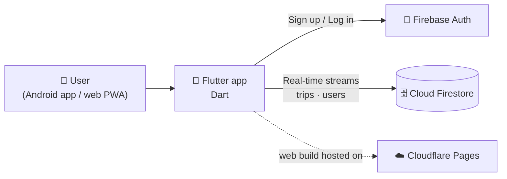

<div align="center">

# ✈️ Trip Split — Share Trip Expenses Easily

**A Splitwise-style Flutter app for splitting group trip expenses, with real-time sync and smart settlements. Runs as an Android app and as an installable web app (PWA).**

[](https://trip-split-6jm.pages.dev/)


[🌐 Live Demo](https://trip-split-6jm.pages.dev/) • [Features](#-features) • [How Settlement Works](#-how-settlements-are-calculated) • [Tech Stack](#-tech-stack) • [Getting Started](#-getting-started) • [Data Model](#-data-model) • [Deployment](#-deployment)

</div>

---

## 📋 Overview

**Trip Split** takes the awkward maths out of group trips. Create a trip, add your friends, log who paid for what and who shared it, and the app tells you exactly **who owes whom** with the fewest possible payments.

Everything syncs live through Firebase, so when one friend adds an expense, everyone in the trip sees it instantly.

> 🌐 **Live app:** https://trip-split-6jm.pages.dev/

> 👨‍💻 **Solo project** — designed, built and deployed by [Ishan Patel](https://github.com/IshanPatel1912).

---

## ✨ Features

### 🔐 Accounts
- Register with name, email and password; log in with email and password
- Auth state handling — signed-out users always land on the login screen

### 🧳 Trips
- Create trips with a title and date
- Your trip list shows only the trips you are a member of
- **Rename** or **delete** a trip from the list
- Real-time updates across all members

### 👥 Members
- **Add friends by their registered email** — they join the trip immediately
- Remove a member, with safety checks:
  - the trip creator cannot be removed
  - a member who is part of any expense cannot be removed until those expenses are deleted

### 💸 Expenses
- Add an expense with a description, amount, **who paid**, and **who is splitting it**
- Edit or delete any expense
- **Filter** expenses by payer
- **Sort** by newest, oldest, highest amount or lowest amount
- Amounts shown in Indian rupees (₹)

### 📊 Three-tab trip view

| Tab | Shows |
|---|---|
| **Overview** | Total trip cost and the list of trip members |
| **Expenses** | Every expense with payer and split count, plus filter and sort |
| **Balances** | Suggested settlements — who pays whom and how much, or "All settled up!" |

### 📱 Progressive Web App
- Installable from the browser on phone and desktop
- Standalone display, custom icons, portrait orientation
- Theme colour `#4F46E5` with a clean indigo UI

---

## 🧮 How Settlements Are Calculated

The Balances tab uses a **greedy debt-minimization algorithm**, the same idea Splitwise uses:

1. **Net balance per person.** Each expense is divided equally among the people who share it. The payer is credited the full amount; every sharer is debited their portion.
2. **Split into two groups.** People with a negative balance are *debtors*; people with a positive balance are *creditors*.
3. **Match them.** Repeatedly pair a debtor with a creditor and settle `min(amount owed, amount due)`, until everyone is at zero.

This keeps the number of payments small. For example, if A paid ₹900 for A, B and C, then B and C each owe A ₹300, and the app shows exactly those two transfers.

---

## 🛠️ Tech Stack

| Layer | Technology |
|---|---|
| **Framework** | Flutter (Dart SDK ^3.10) with Material 3 |
| **Authentication** | Firebase Authentication (email / password) |
| **Database** | Cloud Firestore with real-time `StreamBuilder` listeners |
| **Utilities** | `uuid` for IDs, `intl` for formatting |
| **Web / PWA** | Flutter web build with `manifest.json` |
| **Hosting** | Cloudflare Pages |

---

## 🏗️ Architecture



There is no custom backend: the app talks directly to Firebase, and settlements are computed on the device from the trip's expense list.

### Project structure

```
Trip_split/
└── trip_split/                 # Flutter project
    ├── lib/
    │   ├── main.dart           # Models, auth, trip list, trip detail, expenses, settlements
    │   └── firebase_options.dart
    ├── web/                    # index.html, manifest.json, PWA icons
    ├── android/                # Android runner + google-services.json
    ├── assets/icon.png         # Source icon for launcher icons
    ├── test/                   # Widget test
    ├── pubspec.yaml
    └── firebase.json
```

The app is organized into these screens: `AuthGate` → `LoginScreen` → `TripListScreen` → `TripDetailScreen` (Overview / Expenses / Balances) → `AddExpenseScreen`.

---

## 🚀 Getting Started

### Prerequisites

- [Flutter SDK](https://docs.flutter.dev/get-started/install) with Dart 3.10 or later
- A **Firebase** project with **Authentication (Email/Password)** and **Cloud Firestore** enabled
- For Android: Android Studio and an emulator or device

### 1. Clone and install

```bash
git clone https://github.com/IshanPatel1912/Trip_split.git
cd Trip_split/trip_split
flutter pub get
```

### 2. Connect your own Firebase project

The repo is wired to the author's Firebase project. To run your own copy:

```bash
dart pub global activate flutterfire_cli
flutterfire configure
```

This regenerates `lib/firebase_options.dart` (and `google-services.json` for Android) for your project.

### 3. Firebase setup

1. **Authentication → Sign-in method:** enable **Email/Password**.
2. Create a **Cloud Firestore** database.
3. Add your web domain under **Authentication → Settings → Authorized domains**.
4. Secure your data with Firestore rules so only trip members can read and write their trips. The app reads `users` and `trips`.

### 4. Run

```bash
# Web
flutter run -d chrome

# Android
flutter run
```

### 5. Build

```bash
# Web (PWA)
flutter build web --release

# Android APK
flutter build apk --release
```

The web build is written to `build/web/`.

---

## 🗃️ Data Model

Two Firestore collections.

### `users`

| Field | Type | Notes |
|---|---|---|
| `uid` | string | Firebase Auth UID (also the document ID) |
| `email` | string | Stored in lowercase, used to find friends |
| `name` | string | Display name |

### `trips`

| Field | Type | Notes |
|---|---|---|
| `title` | string | Trip name |
| `date` | timestamp | Trip date |
| `ownerId` | string | The creator's UID |
| `people` | `{ id, name, email }[]` | Trip members |
| `expenses` | `{ id, description, amount, payerId, involvedIds }[]` | All expenses, embedded in the trip |

---

## ☁️ Deployment

The web app is deployed on **Cloudflare Pages** at **https://trip-split-6jm.pages.dev/**.

To deploy your own copy:

1. Run `flutter build web --release` inside `trip_split/`.
2. Upload the `build/web` folder with Cloudflare Pages (direct upload), or connect the repo and use a build setup that installs Flutter.
3. Add the deployed domain to the Firebase **Authorized domains**.

---

## 🗺️ Roadmap

- [ ] Unequal splits (by amount, percentage or shares)
- [ ] "Mark as settled" payments
- [ ] Expense categories and spending charts
- [ ] Multiple currencies
- [ ] Offline support
- [ ] Invite by link

---

## 👤 Author

**Ishan Patel** — Undergraduate student, Pandit Deendayal Energy University (PDEU)

[](https://github.com/IshanPatel1912)

---

## 📜 License

This project is for personal and educational use.

<div align="center">

**Built with ❤️ and Flutter**

[🔝 Back to top](#️-trip-split--share-trip-expenses-easily)

</div>
